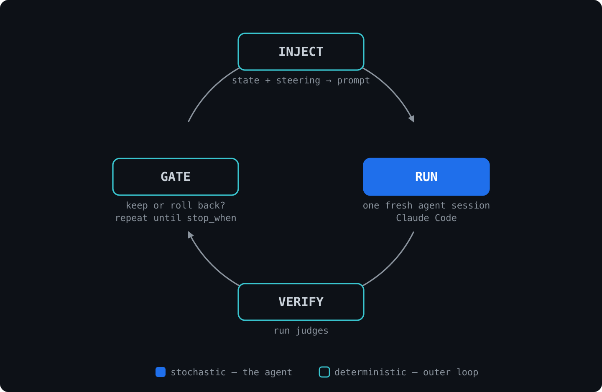
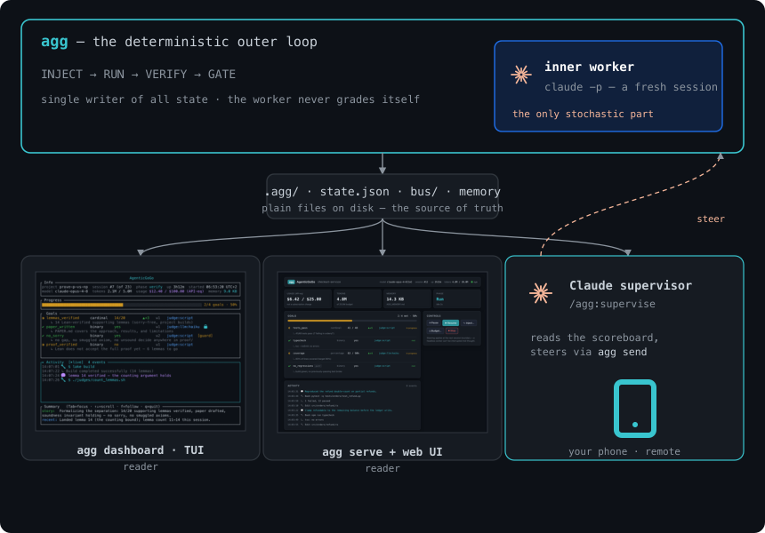

<h1 align="center">
  <br>
  Relentless
</h1>

<p align="center">
  <em>Define your agent workflow as code — YAML or Rust — and let a deterministic outer loop<br>with incorruptible judges drive it to done.</em><br>
  <em><strong>Loop Engineering</strong> · <strong>Graph Engineering</strong> · <strong>Agentic Workflows as Code</strong></em>
</p>

<p align="center"><em>Stop typing “go go”.</em></p>

---

Are you constantly typing **“go go”**, **“continue”**, **“keep going”** to nudge your coding agent
through a long plan? Do even spec-driven approaches stall mid-flight, run out of context, or
quietly stop one step short — leaving you to babysit a terminal?

**Then Relentless is for you.**

Relentless (`rlt`) is a framework for **Loop Engineering** (e.g. Ralph Loops), **Graph Engineering** and
**Agentic Workflows as Code**. You define the workflow as a versioned artifact — in **YAML** for a sequence that laps, or in
**Rust** when the flow has to branch — and `rlt` runs it as a deterministic outer
**[Ralph loop](https://ghuntley.com/ralph/)** around a stochastic inner coding agent (currently
supported: [Claude Code](https://claude.com/claude-code), [OpenAI Codex](https://developers.openai.com/codex/cli), [GitHub Copilot](https://github.com/github/copilot-cli)) — relaunching a **fresh** session each cycle, verifying its work against gates
*it can't fake* (the **judges**), and repeating until your goals are actually met. The loop is plain code: it never hallucinates a decision. The agent does the work, inside one step, and never decides when it's done. *(A similar LLM-based approach — generate → verify → keep, as in evolutionary code search — was
proposed years ago, outside the Ralph-loop community, by DeepMind's
[AlphaCode](https://arxiv.org/abs/2203.07814) and its open-source variant
[CodeEvolve](https://arxiv.org/abs/2510.14150).)*

A **judge** is a small, incorruptible check that decides whether one goal is met — usually a script
inspecting the artifact (tests, a compiler, a proof checker), or an LLM grading against a rubric. You
compose several with a boolean grammar (`and` / `or` / `not`, e.g. `outputs_two and tests_pass`) to
say exactly what *done* means.

**A loop alone is not enough, and this is the part most agent tooling leaves out.** Two more ideas
carry equal weight in `rlt`, and every design decision here follows from one of the three:

- **[Graph Engineering](#2--graph-engineering--a-loop-laps-in-a-fixed-order-a-graph-chooses)** — a
  loop laps in a **fixed order**; a graph **chooses**. Generalise the loop and which step runs next
  can depend on what the last one produced: skip a step a verdict made pointless, take a recovery
  route when the current one is exhausted, run the expensive check only where it can matter.
- **[Agentic Workflows as Code](#3--agentic-workflows-as-code--the-workflow-is-a-reviewable-artifact)**
  — that graph is a **program**, so write it in a language built for control flow. The whole
  orchestration is **committed source**, not a prompt in someone's terminal history. It is also what
  makes the judges incorruptible: they live in git, so a run that tampers with one is rolled back to
  the committed version.

The loop makes it deterministic · the graph lets it **choose** · as-code makes it reviewable.
[Read the three in full ↓](#three-ideas-it-is-built-on)

<p align="center">
  
</p>

| Stage | What it does | Who runs it |
|---|---|---|
| **`INJECT`** | Builds the agent's prompt: your standing instruction, what past sessions learned, any steering you queued. | code |
| **`RUN`** | Launches one **fresh** agent session (`claude -p` · `codex exec` · `copilot -p`). It edits files. It never decides whether it succeeded. | **the agent** |
| **`VERIFY`** | `rlt` runs your **judges** itself. The agent is never asked to grade its own homework. | code |
| **`GATE`** | Keeps or rolls back the work, checks `done_if`, carries state forward — or stops. | code |

Three of the four stages are deterministic code; only the `RUN` stage is a (stochastic) coding agent.
The loop continues until your Definition of Done is met — potentially for hours, days, weeks (watch
your token consumption 😉). Because the agent never runs `VERIFY`, it can't fake the gate that decides
it's done.

**Your judges *are* that gate — your Definition of Done (DoD), made executable.** You compose them
into one expression, `done_if`, that says exactly what *done* means. Good judges are built on
quantifiable goals: *"`solve(Y)` returns `X`"*, *"18 of 28 benchmarks pass"*, *"`f(x)` runs in under
200 ms"*, *"the report scores ≥ 85% against this rubric"* — or any boolean combination of such judges
(`done_if: "solves AND fast_enough"`). A vague DoD like *"make the code nicer"* gives an LLM-based
assessment far too much slack, and is easily gamed.

The overall architecture is captured in the following diagram:

<p align="center">
  
</p>

The whole system is **the loop plus plain files**: `rlt` drives one fresh worker, which writes its own
state to `rlt/state/` while `rlt` writes the run's ledger and scoreboard to `rlt/private/`; the TUI, the
web UI, and an `/rlt:supervise` agent session (reachable from your phone, via Claude
Code's mobile app) all just *read* those files (and the supervisor can *steer* via the bus). More on that in
the [guide](docs/GUIDE.md).

## Three ideas it is built on

### 1 · Loop Engineering — the loop is code, not a conversation

[Ralph](https://ghuntley.com/ralph/) is the insight that a *fresh* agent session in a deterministic
outer loop beats one long conversation: no context rot, no drift, no "where were we". `rlt` is that
loop with the missing half added — **the agent never decides it is done.** Judges do, and the agent
cannot run them.

### 2 · Graph Engineering — a loop laps in a fixed order; a graph chooses

A **loop is the degenerate graph**: one node, one back-edge, one condition. Generalise it and the
transitions become explicit — which step runs next may depend on what the last one produced. That
buys four things a fixed cycle cannot express: **conditional work** (skip a step a verdict made
pointless), **cost control** (order checks cheap-to-expensive and short-circuit), **recovery paths**
(three flat laps → step back, try another approach, escalate to a human), and **bounds that respond
to what the run learned** rather than constants chosen up front.

In `rlt` that is the [Rust driver](#a-driver-in-rust) — and the cost lever is not rhetorical:

```rust
if rlt.judge(&tests).met() && rlt.judge(&load).met() { rlt.gate()?; }
```

`&&` short-circuits, so the 40-minute load test never runs on a red build. In a YAML run-set it would
execute after *every* judged step.

> The word carries a **second sense** here, at a different level: `rlt/state/wiki/` is a knowledge
> graph — one concept per file, typed frontmatter, cross-linked, not an append-only log — so a fresh
> session enters at the right node instead of re-reading everything. Control flow and memory both
> stop being lines. Open `rlt/` as an [Obsidian](https://obsidian.md) vault to see it.

### 3 · Agentic Workflows as Code — the workflow is a reviewable artifact

A graph is a **program**: branches, joins, state between steps, conditions evaluated in flight.
Expressing that in a config format means inventing a small language for control flow — which acquires
a conditional, then an expression syntax, then variables, and arrives at a bad programming language
with no type checker and no debugger. Languages built for control flow already exist.

So the whole orchestration — steps, topology, checks, Definition of Done — is **committed source**:
`rlt/rlt.yaml` + `rlt/judges/*` for a sequence that laps, a **compiled Rust program you can
unit-test** when the flow has to branch. A prompt in someone's terminal history is not reproducible;
this is. It is also *why the moat holds* — the judges are committed, so a run that tampers with one
gets rolled back to the version in git.

**Why "workflows" and not "agents".** The agents stay agents — stochastic, swappable, doing the work
inside one step. It is the *workflow around them* that becomes code. Naming it after the agents points
at the one part of the system that is **not** a reviewable artifact.

## Install

```bash
curl -fsSL https://raw.githubusercontent.com/ssenge/relentless/main/scripts/install.sh | sh
```

Then the `/rlt:*` skills — all three agents share one marketplace:

```
/plugin marketplace add ssenge/relentless     # Claude Code (Codex + Copilot: see the guide)
/plugin install rlt@relentless
```

You also need a coding agent `rlt` can drive **headlessly** — [Claude
Code](https://claude.com/claude-code), [OpenAI
Codex](https://developers.openai.com/codex/cli) or [GitHub
Copilot](https://github.com/github/copilot-cli). Then:

```bash
rlt doctor       # verifies the agent is on PATH *and* can do what your config asks
```

→ [Full install options](docs/INSTALL.md) · [choosing an agent](docs/GUIDE.md#choosing-an-agent)

## A loop in YAML

Two files. `rlt/rlt.yaml` says what to run and when it is done; `rlt/judges/*` decide *done*.

```yaml
# rlt/rlt.yaml
project: calc
defaults: { agent: "claude" }
steps:
  worker:
    prompt: "Fix the failing tests in calc.py. Do not edit the tests."
sequence:
  steps: [worker]                  # a list that laps, forever
  done_if: "tests_pass"            # …until THIS is true
  limits: { sessions: 40 }
```

```bash
#!/usr/bin/env bash
# rlt/judges/tests_pass.sh — rlt runs this; the agent never does
python3 -m pytest -q >/dev/null 2>&1
printf '{"met":%s,"target":1,"rationale":"pytest"}\n' "$([ $? -eq 0 ] && echo true || echo false)"
```

```bash
rlt run                            # …and watch it: rlt dashboard
```

That is the whole model: **a sequence that laps until the judges say done.** Add bounded repetition
(`until:` + `max:`), per-step agents and models, sandboxing, notifications — all still YAML.

→ [Writing judges](docs/GUIDE.md#building-judges) · [steps and
sequences](docs/GUIDE.md#steps-and-sequences) · [full config reference](docs/CONFIG.md)

## A driver in Rust

**This is [Graph Engineering](#2--graph-engineering--a-loop-laps-in-a-fixed-order-a-graph-chooses)
made concrete.** YAML is a list that laps — the degenerate graph. When the flow needs to **branch** —
skip a step on a verdict, or refuse to run a 40-minute judge unless three cheap ones passed — it
becomes an ordinary Rust program against the *same engine*:

```rust
let rlt = Relentless::open(".")?.limits(limits).on_regression(OnRegression::Rollback);

for c in 1..=20 {
    rlt.check_limits()?;
    rlt.step(&implement)?;                     // stages on a session branch; nothing merged yet
    if !(rlt.judge(&tests).met() && rlt.judge(&load).met()) {
        continue;                              // `&&` IS the cost gate: `load` never runs when red
    }
    rlt.gate()?;                               // land the whole span, or discard it per policy
}
```

Judges are **lazy and memoized per step**, which is what makes `&&` a real cost gate. `step()`
stages, `gate()` lands. A crashed run resumes from a call ledger without re-spending a token.

**Heavier and Rust-only — use YAML unless you need flow it cannot express.**

→ [The Rust driver API](docs/RUST_API.md) · working drivers:
[`examples/workflow.rs`](examples/workflow.rs),
[`examples/selfimprove.rs`](examples/selfimprove.rs)

## When a human is unavoidable

Some work genuinely needs a person: an approval before a deploy, a value only they have, a
real-world action no agent can perform, a task the agent tried and failed. Unattended was never the
same as unassisted.

**This is off by default and stays off.** A project that declares no human call runs exactly as it
always did — start to finish, nobody watching. rlt exists because a raw coding agent stops every few
minutes to ask, so **who is allowed to make the loop wait** is the entire design: only a Rust driver,
only at a call site a human wrote. `rlt.yaml` has no `hil` key at all.

The **worker** can be given a channel too (opt-in, per project) — but it asks and *exits*, and can
never make the loop wait. A session is a paid subprocess holding a branch; the answer reaches its
next brief.

```bash
rlt hil bool "Firewall piercing for :443 requested. Done?"   # records, exits — there is no --wait
```

A **driver** may block, because driver code runs between sessions and blocking costs only
wall-clock:

```rust
let i  = rlt.hil_choose("Which store?", &["postgres", "sqlite"])?;   // -> usize
let ok = rlt.hil_bool("Deploy v2.3 to prod?")?;                      // -> bool
```

Answer **whether or not a workflow is running** — an ask outlives the run that raised it — from a
shell, or by clicking the ask panel in `rlt serve`'s web UI. `rlt status` lists open asks with age:

```bash
rlt answer 4f2a 2           # a choice, by name or number; anything off the list is refused
rlt answer 4f2a yes         # a yes/no ask
```

No timeout, no default: an idle process spends no tokens, and `rlt stop` interrupts a wait. Two
rules make that safe — **`work_time` excludes time spent waiting**, so a sleeping human never blows
a ceiling meant to measure the agent's effort; and **a human's answer unblocks the step, while a
judge still owns the verdict**, so a "done" is checked against the world, never taken on trust.

→ [Asking a human](docs/CONFIG.md#asking-a-human-hil) · worked driver:
[`examples/hil.rs`](examples/hil.rs)

## CLI reference

Run from the project root. Full detail in [docs/GUIDE.md](docs/GUIDE.md).

| Command | What it does |
|---|---|
| `rlt init` | Scaffold `rlt.yaml`, `RLT.md`, state and a starter judge |
| `rlt plan` | Dry run: evaluate every judge once, print the starting scoreboard |
| `rlt run` | Run the loop until `done_if` or `abort_if` |
| `rlt status` | Live scoreboard, read from state; cheap, does not re-judge. `--json`: the versioned live status for programs |
| `rlt dashboard` | Live TUI, or a one-shot snapshot with `--once` |
| `rlt doctor` | Check the chosen agent is installed and the config is valid for it |
| `rlt check` | Validate the config as `rlt run` startup would, listing every problem at once (`--json`) |
| `rlt schema` | Print the JSON Schema of `rlt.yaml` |
| `rlt judge <name>` | Run one judge and print its verdict, for authoring and debugging |
| `rlt history` | Run history and lifetime totals, with each run's token and cost usage |
| `rlt send` | Steer a **running** workflow: `inject`, `pause`, `resume`, `wake` (end a rate-limit wait), `budget`, `stop`, `note`. Refused if none is running |
| `rlt answer <id> <val>` | Answer an open human ask. Works with no workflow running — an ask outlives the run that raised it. `--json`: `{accepted, reason, …}` |
| `rlt hil` | **For the worker:** ask a human `bool`/`choose`/`input`. Records and exits — it never waits |
| `rlt stop` | Graceful stop, an alias of `rlt send stop`. Exits **5** — a stop is not a met goal |
| `rlt spawn` | Start a long task that outlives one worker session |
| `rlt skills` | Install the `/rlt:*` skills where your agent finds them |
| `rlt serve` | JSON HTTP API for the web UI |
| `rlt wiki lint` | Check the worker's knowledge wiki against OKF v0.2 (`--json`); read-only |

## Where to go next

| | |
|---|---|
| [**docs/GUIDE.md**](docs/GUIDE.md) | the full walkthrough — install, agents, judges, sequences, state and memory, interfaces, CLI |
| [docs/CONFIG.md](docs/CONFIG.md) | every `rlt.yaml` key, and what a judge may write |
| [docs/RUST_API.md](docs/RUST_API.md) | the driver API, resume, and what a driver author must design around |
| [docs/BACKENDS.md](docs/BACKENDS.md) | adding an agent backend: the contract, capability flags, fixtures, tests |
| [docs/INSTALL.md](docs/INSTALL.md) | prebuilt binaries, from source, version pinning |
| [examples/](examples/) | a full YAML workflow, three Rust drivers (incl. [`hil.rs`](examples/hil.rs)), and a research loop |
| [AGENTS.md](AGENTS.md) | the condensed reference for an agent working **on** this repo |

## License

MIT
