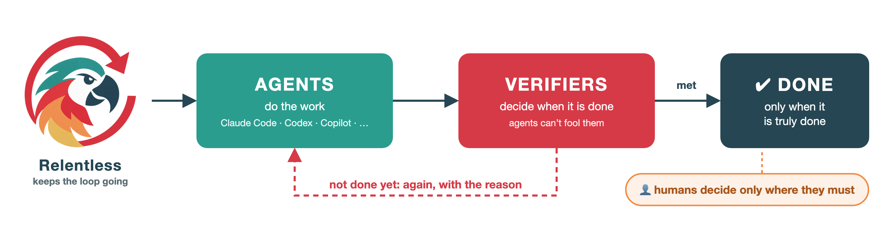
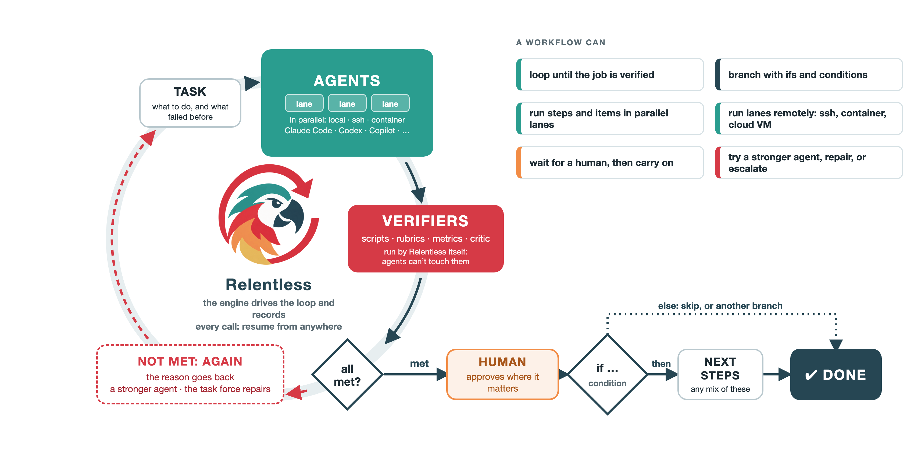
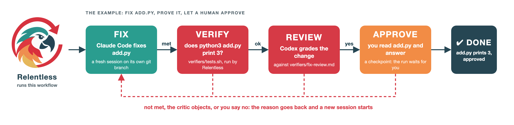

<h1 align="center">
  <br>
  Relentless
</h1>

<p align="center"><strong>Agents that don't stop until the job is truly done.</strong></p>

<p align="center">
  <a href="LICENSE"></a>
  
  
  
  
  
</p>

**Relentless** runs agentic **workflows**: a bug fix, a migration, a whole business process, written in YAML or in Rust.
Coding agents (Claude Code, Codex CLI, GitHub Copilot CLI, …) do the work, **verifiers** they can't fool decide when it is
done, and humans decide only where they must. A long-running agentic job, written as a loop or, more generally, as a
workflow, therefore ends only when the job is *truly* done.

<p align="center">
  
</p>

## Why Relentless

- **Agents grade their own homework.** "Done" is whatever the last message said, and it is often wrong.
- **Long work stalls.** The context fills up, the agent stops one step short, and you end up typing "continue" into a terminal.
- **Relentless takes "done" out of the agent's hands.** The workflow around the agent is code: verifiers the agent can't run
  or edit decide, a verifier that isn't met sends its reason back for another attempt, and a human approves only where it matters.

## Features

Relentless drives a loop: agents work, verifiers decide, and a failed attempt goes around again. The workflow around that loop
can branch, run in parallel and remotely, and wait for humans:

<p align="center">
  
</p>

- **Verifiers decide.** Scripts, rubrics for an agent to grade, metrics such as complexity and coverage, and conditions like
  `done_if: "tests AND docs"`. They are committed in git, and a change a worker makes to one is rolled back.
- **A loop, a workflow or a Rust program.** A loop (`rlt run`) repeats one job; a workflow file (`rlt process`) has phases,
  steps, human checkpoints and `each` over a list; Rust allows any control flow.
- **A fresh session for every attempt**, on its own git branch: kept when verified, rolled back when not. No context rot.
- **Humans where they must.** A checkpoint waits for an answer (`rlt answer`, or the web UI), and what the human decides goes
  back to the step that wrote the document.
- **Parallel by design.** Items, or different steps, at once, each in a worktree of its own: on this machine, over ssh or in
  containers. In Rust, `fork()` and `merge()` with rayon or plain threads.
- **Any agent.** Claude Code, Codex and Copilot CLI; Gemini, OpenCode, Qwen Code and Pi (experimental); or any CLI you describe
  in a few lines.
- **Resume from anywhere.** Every call is recorded: a crash, a stop or a rate limit costs no tokens to continue from.
- **Ladders and a task force.** A cheap agent first, a stronger one when it fails; a failed step has its cause found and
  repaired, is re-entered at an earlier step, or goes to a human.
- **Confined.** Per step: the agent's own permissions, an OS sandbox, or a container with an egress allow-list; paths a worker
  may read but never change.
- **Testable without tokens.** Scenarios play a whole workflow with scripted agents.
- **Observable.** A live TUI, a web UI with the workflow map, reports and timelines, `rlt status --json`.

## How it works

**The problem.** You ask an agent to make the failing tests pass. It edits some files and says *done*, and two tests still
fail. Or it runs out of context halfway, and you type "continue" until you give up. Nobody checks the agent's word, and nobody
keeps it going.

**The solution.** Put a workflow around the agent. Relentless starts it in a fresh session on its own git branch, then **runs
the verifiers itself**: the agent can't run or edit them. A verifier that isn't met sends its reason back for another attempt,
and the work is kept only when every verifier is met. Where a human should look (a design, a release), a checkpoint waits for
an answer. Steps chain into a workflow, and the workflow ends only when it is truly done.

### Your first workflow

A project has a bug: `add.py` should print the sum of 1 and 2, and it prints 2. The job: have an agent fix it, **prove** that it
is fixed, and let a human approve.

<p align="center">
  
</p>

```
my-project/
  add.py                  print(1 + 2 - 1)               # wrong on purpose
  tools.yaml              worker: claude · critic: codex  # which agent works, which one reviews
workflow/
  process.yaml            the workflow, below
  prompts/fix.md          what the agent is told: "Fix add.py so that python3 add.py prints 3. Change only add.py."
  verifiers/tests.sh      the verifier, below
  verifiers/fix-review.md the rubric the reviewing agent grades against
```

The verifier is a script that runs the program and prints a verdict as its last line. This is all a verifier needs to be:

```sh
#!/bin/sh
# A script verifier: it runs the program and prints one JSON line, the verdict. Relentless runs it, never the agent.
out=$(python3 add.py 2>&1)
if [ "$out" = "3" ]; then
  printf '{"met": true, "rationale": "add.py prints 3"}\n'
else
  printf '{"met": false, "rationale": "add.py printed: %s (expected 3)"}\n' "$out"
fi
```

**In YAML.** One agent step that must meet the verifier and pass a review by a second agent, then a checkpoint where you
approve (`examples/hello/process.yaml`):

```yaml
version: 1
roles: { file: tools.yaml }          # in the project: which agent works (the worker) and which one reviews (the critic)
run: { history: reports/steps.jsonl }   # the record of what ran, kept in git
phases:
- id: build
  name: Build
  steps:
  - id: fix
    name: Fix add.py
    kind: agent                        # the agent is told what to do by prompts/fix.md
    verifiers: [verifiers/tests.sh]    # must be met: a script whose last output line is {"met": …, "rationale": …}
    review: true                       # a second agent grades the result against verifiers/fix-review.md
  - id: approve
    name: Human approval
    kind: checkpoint
    doc: add.py                        # what the human reads
    question: "Approve the fix to add.py?"
```

```bash
rlt process workflow/process.yaml my-project
```

The agent works in a fresh session on its own branch. Then Relentless runs `verifiers/tests.sh` itself; if it isn't met, the
reason goes back to the agent for another attempt, and the work is not kept until it is. A second agent reviews. Then the run
stops at the checkpoint, shows you `add.py`, and waits for your answer (`rlt answer`, or the web UI).

The simplest form is a loop: `rlt run` starts a fresh agent session per lap until the verifiers named by `done_if` are met.

```yaml
# rlt/rlt.yaml
project: "demo"
steps: { worker: {} }
sequence: { steps: [worker], done_if: "tests" }     # rlt/verifiers/tests.sh, as above
```

**In Rust.** YAML is enough for most workflows: steps in order, a list of items, human checkpoints, parallel lanes, ladders.
What it can't say is control flow that depends on results: run the slow verifier only when three cheap ones pass, try three
approaches and keep the best, repeat until a metric stops improving. For that, write the same workflow as a Rust program
against the same engine (`examples/fix_add.rs`):

```rust
use relentless::prelude::*;

fn main() -> std::process::ExitCode {
    relentless::driver::run(|| {
        let rlt = Relentless::open(".")?;
        let tests = Verifier::script("tests", "rlt/verifiers/tests.sh");
        let fix = Step::new("fix").prompt("Read task.md and fix add.py. Change nothing else.");

        let mut news = "This is the first attempt.".to_string();
        for attempt in 1..=5 {
            rlt.check_limits()?;
            rlt.step(&fix.clone().news(news))?;      // a fresh agent session, staged on its own branch
            let verdict = rlt.verifier(&tests);      // Relentless runs the verifier, never the agent
            if verdict.met() {
                rlt.gate()?;                         // keep the work: merge the branch
                let approved = rlt.hil_bool("add.py is fixed. Approve?")?;   // a human decides
                println!("approved: {approved}");
                return Ok(());
            }
            news = format!("Attempt {attempt} did not pass: {}", verdict.rationale);   // the reason goes back
        }
        rlt.block("add.py is still wrong after five attempts: a human is needed")?;
        Ok(())
    })
}
```

Same verifiers, same fresh sessions, same resume, same checkpoints and same observability: Rust adds `if`, `for`, `&&` and any
library, and `fork()` and `merge()` for work that runs at once ([the Rust API](docs/RUST_API.md)).

**Try it without tokens.** A scenario plays the YAML workflow with scripted agents:

<!-- check -->
```bash
rlt process examples/hello/process.yaml --scenario examples/hello/scenario.yaml --projects examples/hello/projects
```

## Install

```bash
curl -fsSL https://raw.githubusercontent.com/ssenge/relentless/main/scripts/install.sh | sh
```

Or from source: `cargo install --git https://github.com/ssenge/relentless relentless`. You need `git` and one coding agent
CLI that can run headless: [Claude Code](https://claude.com/claude-code),
[OpenAI Codex](https://developers.openai.com/codex/cli) or [GitHub Copilot](https://github.com/github/copilot-cli).

```bash
rlt doctor     # the agent is on PATH, and can do what your config asks
```

→ [All install options](docs/INSTALL.md) · [choosing an agent](docs/GUIDE.md#choosing-an-agent)

## Verifiers

A verifier decides whether one goal is met. It is the Definition of Done, made executable.

- **Script verifiers.** Any script that prints a verdict as the last line of its output:
  `{"met": true, "rationale": "17 of 17 tests pass"}`. A value and a target make it a number the ratchet can hold.
- **Rubric verifiers.** A `.md` file is a rubric; an agent grades the work against it and answers with the same verdict.
  Use one where only judgement can decide, and keep the rubric narrow.
- **Declared verifiers.** A command met by its exit code, a metric of the code (complexity, coverage, duplication) with
  a bound, or a template a document must follow.
- **Conditions.** `done_if: "tests AND docs"` says what *done* means; `abort_if` says when to give up. A ratchet turns
  "never worse than the last kept result" into a gate.

Verifiers are committed with the project. If a worker changes one, the change is rolled back. They run in the run's
isolation, their verdicts are cached on the content they saw, and the agent never decides that it is done.

→ [Writing verifiers](docs/GUIDE.md#building-verifiers) · [full config reference](docs/CONFIG.md)

## Workflow files

A workflow file (`rlt process`) is a list of phases; each phase is a list of steps of a closed set of kinds:

| Kind | What it does |
|---|---|
| `script` | runs a command; its verdict is the step's |
| `agent` | an agent's task, with `verifiers`, a `review` (a critic agent) and repairs |
| `checkpoint` | a human approves a document; their decisions go back to the step that wrote it |
| `each` | the same steps once per item of a list (at once with `parallel:`) |
| `parallel` | different steps at once, each as a lane in a worktree of its own |
| `exam` | an examinee, a grader and a repairer, in rounds |

Around the steps: **ladders** (a cheap agent first, a stronger one when the cheap one fails), a **task force** that
finds the cause of a failed step and repairs it in place, re-enters an earlier step or asks a human, **re-entry** with
a decision, hooks, a verdict cache, and **scenarios** that play the whole workflow with scripted agents (no tokens) so
control flow can be tested.

→ [Workflow files](docs/PROCESS.md) · [`examples/process/`](examples/process/)

## Running it

- `rlt dashboard`: the live TUI. `rlt serve`: a web UI with the workflow map, open asks, the reviews and the report.
- `rlt process … --report timeline`: what ran, when, and what each step cost.
- **Resume:** `--resume` continues an interrupted run from its call ledger without re-spending a token. A stop
  (`rlt stop`, Ctrl-C) keeps the work.
- **Rate limits:** a limited agent makes the run wait for the reset (`rlt send wake` ends the wait), and it never
  burns attempts on the wait.
- `rlt status --json` gives programs the run's state; `rlt answer` answers an open ask from any shell.

## Agents and where they run

| Agent | `agent:` | Notes |
|---|---|---|
| Claude Code | `claude` | the default; usage and cost reported |
| OpenAI Codex | `codex` | |
| GitHub Copilot CLI | `copilot` | |
| Gemini CLI, OpenCode, Qwen Code, Pi | `gemini`, `opencode`, `qwen`, `pi` | experimental presets of the command harness; so is any CLI you describe under `agents:` |

**Parallel work.** Items of an `each` can run at once (`parallel: { max: 4 }`), and so can different steps (`kind: parallel`): each as
a lane in a worktree of its own, joined in order, on this machine, on another or in a container (`target: { kind: ssh | container |
command }`). See [PROCESS.md](docs/PROCESS.md#parallel-lanes). In Rust there is no scheduler to learn: `rlt.fork()` gives you an
instance in its own worktree, you run it with `rayon` or `std::thread`, and `rlt.merge(fork)` brings its work back
([the Rust API](docs/RUST_API.md#forks-parallel-work), [`examples/forks.rs`](examples/forks.rs)).

A worker's confinement is one of three **isolation** tiers, set per step:

| Tier | What it is |
|---|---|
| `none` | the agent's own permission model |
| `sandbox` | an OS jail (Seatbelt on macOS, bubblewrap on Linux): writes only to the project and the temp folder |
| `container` | Docker or Podman, with an egress allow-list |

→ [Adding an agent](docs/BACKENDS.md) · [isolation](docs/CONFIG.md)

## Learn more

| | |
|---|---|
| [docs/README.md](docs/README.md) | the map of the docs |
| [docs/GUIDE.md](docs/GUIDE.md) | the full walkthrough |
| [docs/PROCESS.md](docs/PROCESS.md) | workflow files: steps, verifiers, ladders, the task force, scenarios |
| [docs/CONFIG.md](docs/CONFIG.md) | every `rlt.yaml` key, and what a verifier may write |
| [docs/RUST_API.md](docs/RUST_API.md) | the Rust API: steps, verifiers, forks, resume |
| [docs/BACKENDS.md](docs/BACKENDS.md) | adding an agent backend |
| [docs/CONCEPTS.md](docs/CONCEPTS.md) | the ideas behind it |
| [AGENTS.md](AGENTS.md) | the reference for an agent working on this repository |

## Where it comes from

The [Ralph loop](https://ghuntley.com/ralph/) showed that a fresh agent session in a deterministic outer loop beats one
long conversation. Relentless adds the missing half, that the agent never decides it is done, and builds on it:
**Loop Engineering** (the loop is code, not a conversation), **Graph Engineering** (a loop laps in a fixed order; a graph
chooses) and **Agentic Workflows as Code** (the workflow is a reviewable artifact). → [docs/CONCEPTS.md](docs/CONCEPTS.md)

## Licence

MIT
