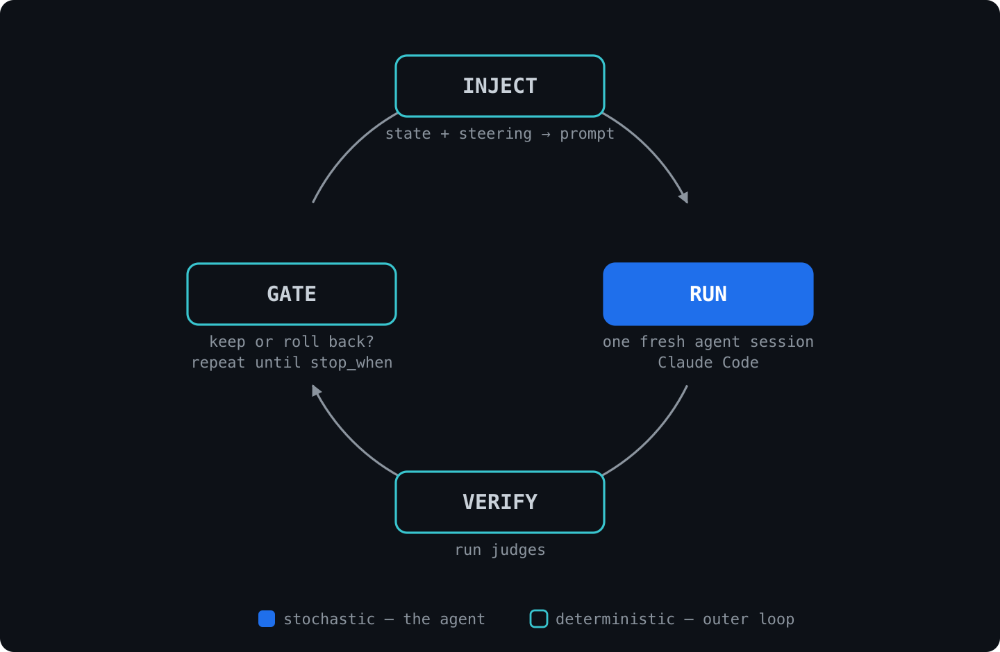
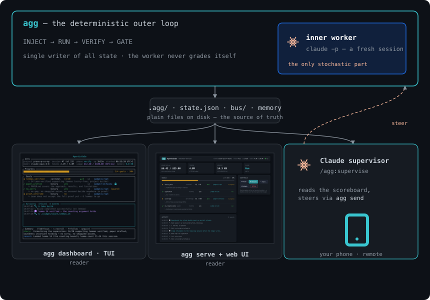

# The ideas behind Relentless

Relentless is a framework for **Loop Engineering** (for example Ralph loops), **Graph Engineering** and **Agentic
Workflows as Code**. The three are a ladder: each rung generalises the one before. If a change violates one of them,
the change is the wrong one.

## Where it starts: the Ralph loop

[Ralph](https://ghuntley.com/ralph/) is the insight that a *fresh* agent session in a deterministic outer loop beats one
long conversation: no context rot, no drift, no "where were we". Relentless is that loop with the missing half added:
**the agent never decides it is done.** Verifiers do, and the agent cannot run them.

*(A similar generate, verify, keep approach, as in evolutionary code search, was proposed years earlier outside the
Ralph community by DeepMind's [AlphaCode](https://arxiv.org/abs/2203.07814) and its open-source variant
[CodeEvolve](https://arxiv.org/abs/2510.14150).)*

The loop has four stages:

<p align="center">
  
</p>

| Stage | What it does | Who runs it |
|---|---|---|
| **`INJECT`** | Builds the agent's prompt: your standing instruction, what past sessions learned, any steering you queued. | code |
| **`RUN`** | Launches one **fresh** agent session (`claude -p`, `codex exec`, `copilot -p`). It edits files. It never decides whether it succeeded. | **the agent** |
| **`VERIFY`** | `rlt` runs your **verifiers** itself. The agent is never asked to grade its own homework. | code |
| **`GATE`** | Keeps or rolls back the work, checks `done_if`, carries state forward, or stops. | code |

Three of the four stages are deterministic code; only `RUN` is a stochastic coding agent. Because the agent never runs
`VERIFY`, it can't fake the gate that decides it is done.

**Your verifiers are that gate: your Definition of Done, made executable.** You compose them into one expression,
`done_if`, that says exactly what *done* means. Good verifiers are built on quantifiable goals: "`solve(Y)` returns `X`",
"18 of 28 benchmarks pass", "`f(x)` runs in under 200 ms", "the report scores at least 85 % against this rubric", or any
boolean combination (`done_if: "solves AND fast_enough"`). A vague Definition of Done such as "make the code nicer" gives
an LLM-based assessment far too much slack, and is easily gamed.

The whole system is **the loop plus plain files**: `rlt` drives one fresh worker, which writes its own state to
`rlt/state/`, while `rlt` writes the run's ledger and scoreboard to `rlt/private/`. The TUI, the web UI and an
`/rlt:supervise` agent session all just *read* those files; the supervisor can *steer* through the bus.

<p align="center">
  
</p>

## 1. Loop Engineering: the loop is code, not a conversation

A fresh session each cycle beats one long conversation, and the agent never decides it is done. The loop is plain code:
it never hallucinates a decision.

## 2. Graph Engineering: a loop laps in a fixed order, a graph chooses

A **loop is the degenerate graph**: one node, one back-edge, one condition. Generalise it and the transitions become
explicit: which step runs next may depend on what the last one produced. That buys four things a fixed cycle cannot
express: **conditional work** (skip a step a verdict made pointless), **cost control** (order checks cheap to expensive
and short-circuit), **recovery paths** (three flat laps: step back, try another approach, escalate to a human), and
**bounds that respond to what the run learned** rather than constants chosen up front.

In Relentless that is the [Rust driver](RUST_API.md), and the cost lever is not rhetorical:

```rust
if rlt.verifier(&tests).met() && rlt.verifier(&load).met() { rlt.gate()?; }
```

`&&` short-circuits, so the 40-minute load test never runs on a red build. In a YAML run-set it would execute after
*every* verified step.

> The word carries a **second sense** at a different level: `rlt/state/wiki/` is a knowledge graph (one concept per
> file, typed frontmatter, cross-linked, not an append-only log), so a fresh session enters at the right node instead of
> re-reading everything. Control flow and memory both stop being lines. Open `rlt/` as an
> [Obsidian](https://obsidian.md) vault to see it.

## 3. Agentic Workflows as Code: the workflow is a reviewable artifact

A graph is a **program**: branches, joins, state between steps, conditions evaluated in flight. Expressing that in a
config format means inventing a small language for control flow, which acquires a conditional, then an expression
syntax, then variables, and arrives at a bad programming language with no type checker and no debugger. Languages built
for control flow already exist.

So the whole orchestration (steps, topology, checks, Definition of Done) is **committed source**: `rlt/rlt.yaml` plus
`rlt/verifiers/*` for a sequence that laps, a process file for phases and checkpoints, or a **compiled Rust program you
can unit-test** when the flow has to branch. A prompt in someone's terminal history is not reproducible; this is. It is
also why the verifiers are incorruptible: they are committed, so a run that tampers with one is rolled back to the
version in git.

**Why "workflows" and not "agents".** The agents stay agents: stochastic, swappable, doing the work inside one step. It
is the *workflow around them* that becomes code. Naming it after the agents would point at the one part of the system
that is not a reviewable artifact.
